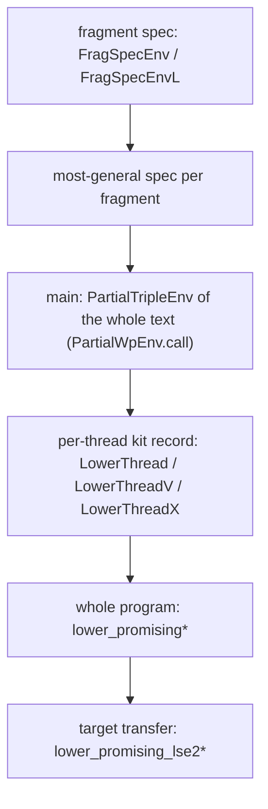

# The lowering layer (`Kraken/Promising/Lower/`)

The Kraken side of lowering source functions (WeakCore's lock-free
structures) to AArch64 and x64 code. This
guide describes the code as it stands. Names are relative to their file's
namespace (`Kit.lower_promising` is `Kraken.Promising.Lower.Kit.lower_promising`).

## 1. Overview

"Lowering" here means: a source function becomes a **fragment** of AArch64 or
x64 code (its first directive is its label; it is entered by `bl`/`call`/a jump
with a return address and left by `ret`/an indirect jump). A lowered program
is one text per thread (`main` plus the fragments it calls). The goal is a
**whole-program theorem on the Promising machine**: every final configuration
reachable from the start states satisfies the source-level property.

The route has two halves:

1. **Per thread, sequential-style reasoning in an environment.** Each fragment
   gets a partial-correctness specification (`Safely`; a CAS retry loop may spin
   forever) in the EnvG environment `counted (EnvGCAdj …)`, which answers the
   thread's shared accesses with what the Promising model allows under an
   ownership plan. A `relPure` twin of the same text proves purity. These are
   proved with `vcgen` and the per-structure VC lemmas (`EnvG/*VC.lean`).
2. **Once for all programs, the adequacy chain.** Theorem 1′ for `NPSafeF`
   (`theorem1FChain`, through `final_of_relPureSafelyF` on AArch64 and
   `CmpxPublic.final_of_relPureSafelyQX_tsoF'` on x64) turns the per-thread
   judgments into the whole-program theorem. The **kits** (`Kit.lean`,
   `KitX64.lean`) package that step, so a program supplies one record per
   thread and one final-state reading.

A separate strand (`Events*.lean`, §3.8) states one fuel-free instruction
step as one memory event, for WeakCore's planned backward simulation.

## 2. Machines and targets

| Name | Meaning |
|---|---|
| `Reachable A fuel` | the executable machine (`succs`, with `certify`) |
| `ReachableSem A fuel` | the semantic machine (certification within `fuel`) |
| `Live.Inf.ReachableSemInf A` | the fuel-free semantic machine (unbounded certification); the form the lowering consumes |
| `ReachableK A` | the "K world" that contains the executable and semantic machines (the K-world chain) |

ISAs: AArch64 `isa` and `isaLSE2` (FEAT_LSE2: `isa` with `execLSE2`/`depsLSE2`),
x64 `isa` (TSO profile). Architectures: `Arch.armv8`, `Arch.tso`. **WeakCore's
AArch64 target is `isaLSE2`** (FEAT_LSE2 only; no LL/SC). The pilots and kits are
proved on `isa`; §3.7 moves them to `isaLSE2`.

## 3. The layers and how they compose



### 3.1 Function specifications

`MachineWP.FunSpecPartialEnv env entry Pre Post`
([AArch64/EnvCallsPartial.lean](../../AArch64/EnvCallsPartial.lean); x64 twin
[X64/EnvCallsPartial.lean](../../X64/EnvCallsPartial.lean)): from every return
address `ra` and every entry state satisfying `Pre`, every run returns to `ra`
with `Post` or runs forever. `MachineWP.PartialWpEnv` is a partial wp at a
point, with `.nil`, `.of_wpEnv` (a `vcgen`-proved total prefix) and `.call` (the
partial call rule for `bl l`). `cfgEnv_partial_fun` is the cfg rule for a
function fragment. The total `fun_specEnv_from_label`/`call_specEnv` do not
apply: a lock-free function's only spec is partial.

Retry loops whose back edge is taken with no shared access ("zero-step" edges)
need a measure: `MachineWP.cfgEnv_partial_fun_guard` and its rank instance
`cfgEnv_partial_fun_edgeRank` ([KitCfg.lean](KitCfg.lean)).

### 3.2 Fragment specifications (placement-independent)

`MachineWP.FragSpecEnv env frag l Pre Post` ([FragSpec.lean](FragSpec.lean);
x64: [FragSpecX64.lean](FragSpecX64.lean), same names): for every `CodeEnv` in
which `frag` is `Program.PlacedIn`, the `FunSpecPartialEnv` holds at label `l`.
It is proved once and used in every program that contains the fragment:

- constructor `FragSpecEnv.of_cfg` (one `cfgEnv_partial_fun` run with the
  placement abstract); `FragSpecEnv.of_cfgRank` for zero-step back edges
  ([FragSpecRank.lean](FragSpecRank.lean));
- client use, one line per function per program:
  `(fragSpec …).of_placed <prog>_placed (by decide)` (`subBlocksOfE` is
  decidable), or `FragSpecEnv.of_layout`; weakening `FragSpecEnv.mono`.

**Calls between fragments** ([FragSpecCalls.lean](FragSpecCalls.lean), the non-leaf call rules):
`FragSpecEnvL env frags l Pre Post` is a spec over a *list* of separately placed
fragments (`[f, callees…]`; one concatenated fragment would force the callee
directly behind the caller). `FragSpecEnv.toL`, `FragSpecEnvL.toFrag`,
`.of_placed`, `.at_sub`, `.mono`. Constructors for the three emitter shapes,
each taking the callee's spec without re-proving it:

- `FragSpecEnvL.call`: `f: A; bl g; B` (non-leaf);
- `FragSpecEnvL.callr`: `f: A; blr xN; B` with `xN = &g` after `A` (indirect);
- `FragSpecEnvL.tail`: `A; b g` (tail call);
- the general form `FragSpecEnvL.of_block`, and the rules `PartialWpEnv.blr`,
  `PartialWpEnv.exit_call`.

Demo: [FragSpecCallsDemo.lean](FragSpecCallsDemo.lean) (`pushw_spec`,
`pusht_spec`, `pushi_spec`, `pushww_spec`, and their `_at` instances in
`callsDemo`). **Scope limit:** the call site must be in the caller's entry
block. Calls inside loops: see [FragSpecLoopCalls.lean](FragSpecLoopCalls.lean)
(the loop-call rules): `FragSpecEnvL.of_cfgP`, where each block is either a
`PartialWpEnv` with EdgeSafe exits or a step-first `PartialWpEnvS`
(`PartialWpEnvS.call_triples` for `A; bl g; B`); demo `popw_spec` in
[FragSpecLoopCallsDemo.lean](FragSpecLoopCallsDemo.lean). x64 tail and
register-link calls: [FragSpecCallsX64.lean](FragSpecCallsX64.lean)
(`FragSpecEnvL.tail`, `FragSpecEnvL.callLink`). Mutual recursion is not covered.

### 3.3 One most-general spec per fragment (the one-spec-per-fragment layer)

[FragSpecUni.lean](FragSpecUni.lean) gives the Treiber `push`/`pop` fragments
**one** spec each, from which every client's spec is `.mono`
([FragSpecUniClients.lean](FragSpecUniClients.lean)):

- environment `EWG P w G`: `EnvGCAdj` with load answers restricted to `G`
  (`valsEnv`). `G = GV P` is the stack-frame pilot's `EWV`; at `G = ⊤`, `valsEnv_top` and
  `FragSpecEnv.of_vals_top` give the plain `EnvGCAdj` spec;
- frame `F : Mem 64 → Prop` on `dmem`, under the word-level condition
  `TFrameOK P w G F` (`tFrameOK_noDmem` for every `G`; `tFrameOK_heapOff` at
  `GV P`);
- post `Saved2` (`x19`–`x28`, `dmem`, `sp`), `F`, the protocol post; `pop`'s
  result carries its `G`-value (`PopResU`).

`pushFrag_specU`, `popFrag_specU`, purity twins `pushFrag_pureU`,
`popFrag_pureU`. The earlier per-client fragment specs are
[FragSpecPilot.lean](FragSpecPilot.lean), [FragSpecClients.lean](FragSpecClients.lean)
(the allocation pilot, the stack-frame pilot), [FragSpecMsq.lean](FragSpecMsq.lean) (the MS queue pilot, with
`of_cfgRank`) and [FragSpecPilotX64.lean](FragSpecPilotX64.lean) (the x64 pilot).

### 3.4 The per-thread kit contract

**AArch64** ([Kit.lean](Kit.lean), the lowering kit), namespace `Kit`:

- `LowerCore A tid rel B`: layout `l`, text `p`, `valid`, plan `pl`/`hpl`,
  `live : (l p).rmwLive`, `shape : Phase1TreeF (l p)`, `stuck` (no step at the
  end of the text), the counted post `Q` with `hB` (the post read as the shared
  postcondition `B`), and the relPure twin `pure : PartialTripleEnv … PreR p QR`;
- `LowerThread` (frameless) adds `Pre` and
  `main : PartialTripleEnv (counted (EnvGCAdjA A tid pl)) Pre p Q`;
- `LowerThreadV` (frame + value bridge) adds `main` in
  `counted (Vals.EnvGCAdjV A tid pl G)` and a value triple `vals` in
  `counted (inv S G)`;
- start predicates `LowerCore.StartC` (`exe`, `decls = {}`, `endPc`,
  `pc = addrOf 0`, `PreR`), `LowerThread.Start`, `LowerThreadV.Start`.

Each judgment is a whole-text `PartialTripleEnv`: the thread starts at
`(l p).addrOf 0` and ends at `(l p).addrOf p.length`. `LowerThread.rule` and
`LowerThread.rule_noFault` (needs the static `DirsNoFault`) give the thread rule
and its no-fault corollary.

**x64** ([KitX64.lean](KitX64.lean), the x64 kit), namespace `KitX`: `LowerCoreX tid S B`,
`LowerThreadX`, `LowerThreadXV`, with every judgment a `Safely` judgment of a
laid-out image `e` from an `entry` address (covers runner images and, via
`safely_of_partialTripleEnvX`, whole texts). The shared layout `S` is a
parameter (`Le16 S`), and purity is the all-release judgment in counted
`(relPureQ Arch.tso ⊥).within S`. Helpers: [KitX64Wp.lean](KitX64Wp.lean)
(`PartialWpEnv.seg`, `.append_false`, `ja_not_taken`) and
[KitX64Link.lean](KitX64Link.lean) (`FunSpecPartialEnv.jcallLink`,
`Safely.blockAtLabel` for the register-link convention).

### 3.5 The whole program

| Theorem | ISA / machine | Route |
|---|---|---|
| `Kit.lower_promising` | AArch64 `isa`, `Reachable A fuel` | `final_of_relPureSafelyF` |
| `Kit.lower_promising_vals` | same, plus `hm0 : MemInv G` of the initial memory | `Vals.envGValsBridge_ofSpecs` |
| `KitX.lower_promising_x64` | x64, `Reachable Arch.tso fuel` | `CmpxPublic.final_of_relPureSafelyQX_tsoF'` |
| `KitX.lower_promising_x64_vals` | same, plus `MemInv G` | `Vals.envGValsBridgeX_ofSpecs` (unrestricted purity only, §6.3) |

Inputs: `hE` (`Erase` of the initial configuration), `hpend`, one record `T tid h`
per thread below `states.length`, `hS` (each thread at its `Start`), and the
final reading `hfin` (the done threads' shared postconditions give `Φ`). The
AArch64 kit also takes `hH` (no non-temporal store along the run; under
`Arch.armv8`, `Config.ntFree_armv8`). Thread ids beyond `states.length` get the
dummy `emptyExe`. `hfin` is a property of the data structure, written once per
structure: `KitPilot.treiber2DFinal_of_hB` (two-thread Treiber, AArch64),
`MsQueue.msqueue2_final_of_hB`, `PilotX.pilotX_final` (x64 Treiber).

### 3.6 The value bridge

A load through a pointer read from shared memory (Treiber `pop`'s link load)
needs a value fact that the ownership environment does not give. The value bridge
(`Promising/SLR/EnvG/Vals{Link,Token,Chain,A64,X64}.lean`) supplies it by a
per-thread value specification: `Vals.envGValsBridge_ofSpecs` (AArch64) and
`Vals.envGValsBridgeX_ofSpecs` (x64) take judgments in
`EnvGCAdjV = valsEnv (EnvGCAdjA …) G` plus a `ThreadSpec` per thread in
`inv S G` and `MemInv G` initially. The kits' `_vals` variants are these
bridges packaged.

The private-memory side is the private-stack layer ([DStack.lean](DStack.lean), ISA-neutral):
`HeapOff H dmem` (no heap byte is private, so every heap access is a shared
event), kept by every private store (`dom dmem` never grows), set up
statically by `StackDom`/`HeapSep`. [DStackA64.lean](DStackA64.lean) and
[DStackX64.lean](DStackX64.lean) prove that such store-closed `dmem` invariants
hold along every env run (`safely_dmem`); [DStackTreiber2A64.lean](DStackTreiber2A64.lean)
is the `treiber2` worker under `HeapOff`.

### 3.7 Target transfer to `isaLSE2`

`isa` and `isaLSE2` differ only at 64-bit `LDP`/`STP` cells.
[Variant.lean](Variant.lean) is the generic layer for two ISAs that differ only
in `exec`/`deps` (`ISA.withExec`, `Agree`, the casts `castC`/`uncastC`, all
semantic, fuel-free and `ReachableK` transfers). [LSE2Transfer.lean](LSE2Transfer.lean)
instantiates it (`NoLSE2Pairs`, decidable through `noLSE2Pairs_apply`;
`agreeLSE2`; `reachableK_of_reachable_lse2`). The executable machine itself is
not transferred (`certify`'s caches are keyed on `Thread I`), so the route goes
through the K world:

- [LSE2Final.lean](LSE2Final.lean): `final_lse2_of_K`, `final_lse2_sem_of_K`,
  `final_lse2_semInf_of_K` (a `ReachableK isa` conclusion holds through `ofL` on
  all three `isaLSE2` machines when no start text has an LSE2 pair), and the K
  twins of the value bridge chain (`envGValsBridge_ofSpecsK`, …);
- [KitLSE2.lean](KitLSE2.lean): `Kit.lower_promising_lse2`,
  `Kit.lower_promising_vals_lse2` and their `_sem`/`_semInf` forms. Changes from
  the kit: `hH` along `ReachableK` (`Config.ntFree_armv8K`), `hfree` (no
  `LDP`/`STP` in any text, `by decide`), and `hfin : FinalReading …` for every
  final configuration. **No per-program clone.**

A hand-assembled headline instead takes one `#chaink_clone'` of the headline
plus one corollary per machine (`PilotLSE2.lean`, `Pilot2LSE2.lean`,
`MsqPilotLSE2.lean`). **Limit:** no 64-bit `LDP`/`STP` in the text.

### 3.8 Instruction-to-event lemmas (for the backward simulation)

[Events.lean](Events.lean) (ISA-neutral: `instrSemInf_iff_of_exec`,
`run_load_iff`, `run_rmw_iff`, …) says what one `InstrSemInf` step is;
`EventsA64*.lean` and `EventsX64*.lean` give each lowering-table row's event
(all widths, LSE2 pairs, `casp`, `movups`); [CallsA64.lean](CallsA64.lean):
`bl`/`blr`/`ret`/`br` are no-event steps. [TsoCollapse.lean](TsoCollapse.lean):
which x64 annotation erasures change nothing on `Arch.tso` (a `.acq` load is
stricter, `readSuccs_acq_eq`); [TsoViewSim.lean](TsoViewSim.lean): `fence .st`
on `Arch.tso` is a stutter up to an invisible `vwNew` difference.

## 4. A worked path: the allocation pilot, end to end

The allocating Treiber client `main(v) { n := new {v, null}; push(&top, n);
r := pop(&top); if r ≠ null then res := r.v }`, two threads, AArch64.

1. **Program** ([AllocProg.lean](AllocProg.lean)): `allocP` (`main`, the runtime
   leaf `alloc`, the first lowering pilot's `push`/`pop`); static facts `allocP_rmwLive`,
   `allocP_phase1F`, `allocP_noFault` (and `allocP_placed` in `AllocSpecs`).
2. **Function specs** ([AllocSpecs.lean](AllocSpecs.lean)): `alloc_spec` (for
   every environment: `alloc` makes no memory access), `push_spec`, `pop_spec`
   in `counted (EW P w)`. The same follow in one line each from the fragment
   specs: `Alloc.push_spec_viaFrag`, `Alloc.alloc_spec_viaFrag`
   ([FragSpecClients.lean](FragSpecClients.lean)), and from the one-spec-per-fragment layer by `.mono`.
3. **`main`** ([AllocMain.lean](AllocMain.lean)): `main_partialTripleEnv`, the
   whole text from `MainPre` to `DnD`, by `vcgen` on the straight pieces and
   `PartialWpEnv.call` at each `bl`.
4. **Purity twin** ([AllocPure.lean](AllocPure.lean)): `main_pure` in `RP rel`.
5. **Kit record** ([AllocWhole.lean](AllocWhole.lean)): every field is a lemma
   from steps 1–4 (abridged: layout arguments and four fields omitted).

   ```lean
   noncomputable def allocT … : LowerThread Arch.armv8 w (ghost₀ P).rel (TB2D P) where
     l := l; p := allocP; pl := plan P w; hpl := plan_valid P w
     live := allocP_rmwLive; shape := allocP_phase1F
     stuck env := not_instrStepEnv_of_end_labels env 1
     Q s σ := DnD P w s.regs.X10.toBitVec s.regs.X11.toBitVec σ.1
     hB := hB_A P hw
     pure := main_pure _ P.t (P.n w) hd hn
     main := main_partialTripleEnv P w hL hw d hD
     …
   ```

   `StartA` is what the runtime sets up (`x30` = end of text, `x21 = &top`,
   `x27 = n` with `x27 + 16 ≤ x28`, payload in `w20`, no `dmem` word);
   `allocT_start` turns it into `LowerThread.Start`.
6. **Whole program on `isa`**: `alloc_promising` is, schematically, one call
   `lower_promising Arch.armv8 fuel (fun _ hc' => Config.ntFree_armv8 hc') (erase_init hL _) rfl T hS hc hf (KitPilot.treiber2DFinal_of_hB hL hf rfl)`.
7. **On `isaLSE2`** ([AllocLSE2.lean](AllocLSE2.lean)): `alloc_promising_lse2`
   (and `_sem`, `_semInf`, `_concrete`) is the same call to
   `Kit.lower_promising_lse2`, with `hH := fun _ hc' => Config.ntFree_armv8K hc'`,
   `hfree` from `allocP_lse2Free`, and the final reading for every final `c`.
   The `_concrete` forms (garbage arenas) assume only `hc`, `hf`.

The first lowering pilot's kit instance takes the same path: `KitPilot.pilotT`,
`KitPilot.pilot_promising_viaKit`, and `KitPilot.pilot_promising_lse2_viaKit`
([AllocLSE2.lean](AllocLSE2.lean); `rfl`-equal to `Pilot.pilot_promising_lse2`).

## 5. The pilots

Conclusions hold for every reachable final configuration. "Start only": every
hypothesis is about the start states and initial memory; `_concrete` discharges them.

| Pilot | ISA / Arch | Convention | Headline (file) | Hypotheses | Status |
|---|---|---|---|---|---|
| The first lowering pilot | AArch64 `isa`, `armv8` | frameless (`x30` in `x19`), inline bump | `Pilot.pilot_promising`, `_concrete` ([PilotWhole](PilotWhole.lean)); `KitPilot.pilot_promising_viaKit` ([KitPilot](KitPilot.lean)) | start only (`StartP`, `top = 0`) | proved |
| The first lowering pilot on LSE2 | `isaLSE2` | same | `Pilot.pilot_promising_lse2`, `_sem`, `_semInf`, `_concrete` ([PilotLSE2](PilotLSE2.lean), clone route); `KitPilot.pilot_promising_lse2_viaKit` ([AllocLSE2](AllocLSE2.lean)) | start only | proved |
| The allocation pilot | AArch64 `isa`, `armv8` | frameless, `bl alloc` (x27/x28) | `Alloc.alloc_promising`, `_concrete` ([AllocWhole](AllocWhole.lean)) | start only (`StartA`, `top = 0`; arena contents arbitrary) | proved |
| The allocation pilot on LSE2 | `isaLSE2` | same | `Alloc.alloc_promising_lse2`, `_sem`, `_semInf`, `_concrete` ([AllocLSE2](AllocLSE2.lean)) | start only | proved |
| The stack-frame pilot | AArch64 `isa`, `armv8` | `dmem` frame (`str x30,[sp,#-16]!`) | `Pilot2.pilot2_promising_of_envGValsBridge`, `pilot2_promising_concrete` ([Pilot2Whole](Pilot2Whole.lean)) | **conditional**: `EnvGValsBridge (treiber2GA t n0 n1)`, `Pilot2ValsReach` | kept unchanged |
| The unconditional stack-frame pilot | same | same + value spec | `Pilot2.pilot2_promising`, `pilot2_promising_concrete'` ([Pilot2ValsWhole](Pilot2ValsWhole.lean)); `KitPilot2.pilot2_promising_viaKit` | start only (adds `hN0`, `hN1`: links initially 0) | proved |
| The unconditional stack-frame pilot on LSE2 | `isaLSE2` | same | `Pilot2.pilot2_promising_lse2`, `_sem`, `_semInf`, `_concrete` ([Pilot2LSE2](Pilot2LSE2.lean)) | start only | proved |
| The MS queue pilot | AArch64 `isa`, `armv8` | frameless, static nodes in `x22`/`x23` | `MsqPilot.msqPilot_promising`, `_concrete` ([MsqPilotWhole](MsqPilotWhole.lean)); `KitMsq.msqPilot_promising_viaKit` | start only (`StartE`/`StartD`, `InitV2`, `t = h + 8`) | proved |
| The MS queue pilot on LSE2 | `isaLSE2` | same | `MsqPilot.msqPilot_promising_lse2`, `_sem`, `_semInf`, `_concrete` ([MsqPilotLSE2](MsqPilotLSE2.lean)); `KitMsq.msqPilot_promising_lse2_viaKit` ([KitMsqLSE2](KitMsqLSE2.lean)) | start only | proved |
| The x64 pilot | x64, `tso` | `call`/`ret`, `dmem` stack | `PilotX.pilotX_promising` ([PilotX64Whole](PilotX64Whole.lean), via `Vals.envGValsBridgeX_ofPure`), `pilotX_promising_sem`/`_semInf` ([PilotsX64Sem](PilotsX64Sem.lean)), `Concrete.pilotX_concrete` ([PilotX64Concrete](PilotX64Concrete.lean)); per-thread pieces `main_specX`, `hthr_pX`, `pilotX_final`; conditional `pilotX_promising_of_bridge_pure` ([PilotX64Link](PilotX64Link.lean)) | start only (`StartPX`, `top = 0`, initial memory in `GV P`) | proved |
| The x64 register-link pilot | x64, `tso` | stackless register link (`r11`) | `PilotXR.pilotXR_promising` ([PilotXRWhole](PilotXRWhole.lean)), `pilotXR_concrete` ([PilotXRConcrete](PilotXRConcrete.lean)) | start only (`StartXR`, `top = 0`) | proved |
| The x64 MS queue pilot | x64, `tso` | stackless register link (`r11`), one text, two entries | `MsqXR.msqXR_promising` ([MsqXRWhole](MsqXRWhole.lean)), `MsqXR.Concrete.msqXR_concrete` ([MsqXRConcrete](MsqXRConcrete.lean)) | start only (`StartE`/`StartD`, `InitV`, `QLocs`, `trk = false`) | proved (FIFO) |
| The allocating MS queue pilot | AArch64 `isa` and `isaLSE2`, `armv8` | frameless, two `bl alloc` in the enqueuer; **pre-zeroed arena** (null fields not stored; matches WeakCore only under its Zeroable-`new` option A′) | `MsqAlloc.msqAlloc_promising`, `_lse2`, `_concrete`, `_lse2_concrete` ([MsqAllocWhole](MsqAllocWhole.lean)) | start only (`StartA`: `x27 = base`, room for 2 nodes; arena links 0; disjointness; `n2 = n1 + 16` by definition of `pA`) | proved (FIFO) |
| The publish pilot | AArch64 `isa` and `isaLSE2`, `armv8` | as the allocation pilot; push behind `pushp: dmb ishst; b push` (WeakCore's `publish`) | `Publish.publish_promising`, `_lse2` ([PublishWhole](PublishWhole.lean)); push spec reused via `FragSpecEnvL.tail`; fence VCs by `FenceMono.ok_fence`/`le_of_fence_step` ([FenceMono](FenceMono.lean)) | start only (as the allocation pilot) | proved |
| The x64 event lemmas | x64, `tso` | event-level lemmas (no program) | `Tso.reachableSemInf_ldFold`, `Tso.instrSemInf_fence_ld_stutter`, `X64.instrSemInf_lfence_stutter` ([EventsX64Fence](EventsX64Fence.lean)); `X64.instrSemInf_lockBin` ([EventsX64LockBin](EventsX64LockBin.lean)); CAS-loop fetch-or/and/xor `FetchOpX.fetchOpFragX_spec` (any `[E.Skips]` env under rely `J`; [FetchOpX64](FetchOpX64.lean)) | none (fragment spec) | proved |
| The fragment kit | AArch64 `isa`, `armv8` | kit bridge: a placement-generic `FragSpecEnvL` for `main` gives the kit's `main` field | `Kit.partialTripleEnv_of_fragL`, `Kit.LowerThread.ofFrag` ([KitFrag](KitFrag.lean)); `FragKit.main_fragL` once ([FragKitMain](FragKitMain.lean)); `publish_promising_viaFragKit`, `alloc_promising_viaFragKit` (statements equal the original ones by `rfl`; [FragKitPublish](FragKitPublish.lean)) | as the publish pilot/the allocation pilot | proved; `main` per text ~13 lines instead of ~240; `pure` still per text |
| The purity kit | AArch64 `isa`, `armv8` | kit bridge for `LowerCore.pure`: a relPure `FragSpecEnvL` for `main` | `Kit.LowerStatic.ofFragPure`, `FragKit.main_pure_fragL` ([FragKitPure](FragKitPure.lean)); `publish_promising_viaFragKit2`, `alloc_promising_viaFragKit2` (no per-text `main`/`pure` proof; `rfl`-equal statements; [FragKitPublish2](FragKitPublish2.lean)) | as the publish pilot/the allocation pilot | proved; `pure` per text ~9 lines instead of ~130–245 |
| The x64 allocating MS queue pilot | x64, `tso` | stackless register link; `alloc` leaf `rax := r14; r14 += 16` (limit `r15`); pre-zeroed arena; link at `[n]`, payload at `[n+8]` (reverse of WeakCore's `node`) | `MsqAllocX.msqAllocX_promising`, `msqAllocX_concrete` ([MsqAllocXWhole](MsqAllocXWhole.lean)); `allocFragX_spec` ([MsqAllocXMain](MsqAllocXMain.lean)) | start only (`ArenaLocs`, `StartA`, `StartD`, `InitV`) | proved (node-identity FIFO; payload not covered) |
| The x64 fragment kit | x64, `tso` | x64 kit bridge: placement-generic `FragSpecEnvL` (register link) gives `LowerThreadX.main`/`LowerCoreX.pure` | `KitX.safely_of_fragL`, `LowerThreadX.ofFrag`, `LowerStaticX.ofFragPure` ([KitFragX](KitFragX.lean)); `FragKitX.msqXR_promising_viaFragKitX` (`rfl`-equal to `MsqXR.msqXR_promising`; [FragKitMsqX](FragKitMsqX.lean)) | as the x64 MS queue pilot | proved; per text ~40 lines instead of ~290 |
| The x64 semantic-machine kit | x64, `tso` | semantic-machine forms of the x64 kit | `KitX.lower_promising_x64_sem`, `_semInf` (via the `#chaink_clone'` K route; [KitX64Sem](KitX64Sem.lean)); `pilotXR_promising_sem`/`_semInf`, `msqXR_promising_sem`/`_semInf`, `msqAllocX_promising_sem`/`_semInf`, `pilotX_promising_sem`/`_semInf` ([PilotsX64Sem](PilotsX64Sem.lean)); the value-restricted purity bridge `Vals.envGValsBridgeX_ofPure_sem`/`_semInf` (via `ReachableK` clones of `PromisePureVals` and `KitX64ValsPure`; [KitX64ValsPureSem](KitX64ValsPureSem.lean)) | as the executable forms | proved; `_vals` kit form executable only |
| The x64 value-restricted kit on the semantic machines | x64, `tso` | the premises of `lower_promising_x64_vals` | `KitX.lower_promising_x64_vals_sem`, `_semInf` (via `ReachableK` clones of `ValsChain`, `ValsX64` and `KitX64`; [KitX64ValsSem](KitX64ValsSem.lean)) | as `lower_promising_x64_vals` | proved; no program instantiates the x64 value-restricted kit yet |
| The FlatHashMap `lookup` lowering | AArch64, sequential (owned data; no weak-memory reasoning) | leaf `flatLookup` (x0 = ctrl buf, x1 = slot buf, x2 = m, x3 = c, x4 = key; result tag/value in x0/x1) | `Flat.groupMatch_spec` ([FlatGroupMatch](FlatGroupMatch.lean)); `Flat.lookup_spec`, `Flat.lookup_tbl1`; WP rules `rbit_spec`, `clz_spec`, `umulh_spec` ([FlatLookup](FlatLookup.lean)) | `Tbl.InMem`, `Tbl.Bounded`, `ProbeEnds` (start-state; non-vacuous at `tbl1`) | proved (portable variant, `Int` keys/values in [0, 2^64)) |
| The FlatHashMap `lookup` lowering, x64 | x64, sequential (owned data; no weak-memory reasoning) | leaf `flatLookupX` (rdi = descriptor of ctrl buf, slot buf, m, c; rsi = key; result tag/value in rax/rdx); BMI2 `mulx`, BMI1 `tzcnt` | `Flat.groupMatchX_spec` ([FlatGroupMatchX64](FlatGroupMatchX64.lean)); `Flat.lookup_specX`, `Flat.lookup_tbl1X` ([FlatLookupX64](FlatLookupX64.lean)); model shared with AArch64 in [FlatModel](FlatModel.lean); WP rules `tzcnt_reg_spec` (`MachineWP.lean`) and the ALU/load rules of `MachineWPALU.lean` | `Tbl.InMemX` (descriptor and buffers), `Tbl.Bounded`, `ProbeEnds` (start-state; non-vacuous at `tbl1`) | proved (portable variant, `Int` keys/values in [0, 2^64)) |
| The FlatHashMap `take` lowering | AArch64, sequential (owned data; no weak-memory reasoning) | leaf `flatTake` (x0 = ctrl buf, x1 = slot buf, x2 = m, x3 = c, x4 = key, x10 = growth_left, x11 = n; result tag/value in x0/x1, gl'/n' in x10/x11; buffers updated in place) | `Flat.Take.take_spec`; `take_tbl1_hit`, `take_tbl1_miss` ([FlatTake](FlatTake.lean)) | The FlatHashMap `lookup` lowering's `LookupPre` + `Extra` (`Sep`; gl, n < 2^64) (start-state; non-vacuous at `tbl1`) | proved (portable variant; control byte as a word read-modify-write; `xchgAtF` as plain ldr+str on an owned buffer; frame outside both buffers) |
| The FlatHashMap `insert` lowering | AArch64, sequential (owned data; no weak-memory reasoning) | leaf `flatInsert` (x0..x7 = ctrl buf, slot buf, m, c, key, value, growth_left, n; result tag/value in x0/x1, gl'/n' in x2/x3; buffers updated in place) | `Flat.insert_spec`; `insert_tbl1_replace`, `insert_tbl1_fresh`, `lookup_tbl1Mem`, `tbl1_inMem` ([FlatInsert](FlatInsert.lean)) | `InsArgs`, `InMem`, `Bounded`, `Tbl.Sep`, `ProbeEnds`, `GrowthLeft` (start-state; concrete instances take only `InsArgs`) | proved (portable variant; no growth: grow stub excluded by `GrowthLeft`; control byte as a word read-modify-write) |
| FlatHashMap `take` then `lookup` on the Promising machine | AArch64 `isa` (and `isaLSE2`, fuel-free), `armv8` | one thread, table in private `dmem`; sequential specs lifted by `FragSpecEnvL.ofProcSpec` | `Flat.Whole.flatWhole_promising`, `_lse2_semInf`, `flatWhole_tbl1` ([FlatWhole](FlatWhole.lean), [FlatWholeSpec](FlatWholeSpec.lean), [FlatWholeProg](FlatWholeProg.lean)) | start only (table in `dmem`) | proved |
| MS queue `enq` with a private-memory frame; FlatHashMap `lookup` feeding the queue | AArch64 `isa`, `armv8`, value-restricted env (`valsEnv`) | `enq` in `EQG P G` with frame `QFrameOK` (re-derives the existing `enqFrag_spec`); thread 0's `main` = lifted `lookup` + two `enq` calls | `MsqPilot.enqFrag_specF`, `MsqPilot.enqFrag_pureF` ([MsqPilotEnqFrame](MsqPilotEnqFrame.lean)), `Flat.Mix.mixMain_fragL` ([FlatMixMain](FlatMixMain.lean)) | fragment level; enqueued data's low 32 bits = 1 (queue protocol fixes data) | proved (no whole-program theorem yet) |
| FlatHashMap `lookup` feeding the MS queue, whole program (two threads: lookup + two `enq`; dequeuer) | AArch64 `isa`, `armv8`, value-restricted kit (`KitVals.lower_promising_valsW`) | layouts, `MixStart` (lookup precondition, `Low1` of the hit value, private queue memory), dequeuer start, `InitV2`, initial messages in `QG` | `Flat.Mix.mixProg_promising`, `mixProg_promising_tblD` ([FlatMixVals](FlatMixVals.lean), [FlatMixWhole](FlatMixWhole.lean)) | final: queue law and thread 0's `x20` = lookup result (or 1 on a miss); concrete instance `tblD` (table control word at `0x3000`, off the queue), key 6, with an explorer check | proved |
| FlatHashMap `lookup` feeding the MS queue: FEAT_LSE2 forms and the concrete instance on `isaLSE2` | AArch64 `isaLSE2`; executable and infinite-run machines | as `mixProg_promising` | `Flat.Mix.mixProg_promising_lse2`, `mixProg_promising_lse2_semInf`, `mixProg_promising_tblD_lse2_semInf` ([FlatMixForms](FlatMixForms.lean)) | `MixFinal x (ofL cfg)`; the `tblD` instance of [FlatMixWhole](FlatMixWhole.lean) | proved |
| WeakCore's MS queue: `deq` without a head = tail check (payload loaded after the CAS), `enq` with plain `ldr` | AArch64 `isa`/`isaLSE2`, `armv8`; executable, semantic and infinite-run forms | shape A: one enqueuer, one dequeuer calling twice; each result empty or 1/2, both values ⇒ FIFO. Shape B: two dequeuers; results empty or 1/2, both values ⇒ {1,2} | `WcMsq.wcMsq_promising`, `wcMsqF_promising(_lse2)`, `wcMsq(F)_promising_lse2_sem(Inf)`, `wcMsqB_promising(_lse2_semInf)` ([WcMsqWhole](WcMsqWhole.lean), [WcEnqWhole](WcEnqWhole.lean), [WcMsqForms](WcMsqForms.lean), [WcMsqBWhole](WcMsqBWhole.lean)) | data fixed to 1/2 (queue protocol); (empty,2)/(2,empty) never reached but not excluded (no per-writer tracking) | proved |
| FlatHashMap `grow` (`rawIns`, `mvL`, `mvG`) on caller-provided zeroed buffers | AArch64, sequential machine-founded wp (total) | `grow_spec`: the entries are moved into the new table, old slots zeroed, memory outside both tables unchanged; `full1_hyps` shows the start-state hypotheses (incl. termination) hold at a full one-group table | `Flat.Grow.grow_spec`, `full1_hyps`, `full1_grow` ([FlatGrow](FlatGrow.lean)) | no `newBuf`; results in `insert`'s argument registers; `GrowKeeps` proved by `decide` at `full1` only | proved |
| Kit form over value-restricted environments; purity step with private data | AArch64 `isa`; ISA-neutral purity lemma | `lower_promising_valsW` (pure, main and vals triples all over `G`-restricted answers); `envGValsBridge_ofSpecsP` accepts purity specs in `valsEnv (relPure …) G`; `lower_promising_vals_viaW` re-derives the original `lower_promising_vals` | `KitVals.lower_promising_valsW`, `envGValsBridge_ofSpecsP`, `SLR.promisePure_of_relWritesV` ([KitVals](KitVals.lean), [KitValsPure](KitValsPure.lean), [PromisePureVals](../SLR/PromisePureVals.lean)) | no program instance yet (the two-thread FlatHashMap→queue program is next) | proved |
| Kit form over value-restricted environments, FEAT_LSE2 and infinite-run machines | AArch64 `isaLSE2` (via the `ReachableK` clones of `KitVals`/`KitValsPure`) | the premises of `lower_promising_valsW`, plus `hfree` (no LSE2 pair cell) and `Kit.FinalReading` | `KitVals.lower_promising_valsW_lse2`, `lower_promising_valsW_lse2_semInf` ([KitValsLSE2](KitValsLSE2.lean)) | `Φ (ofL cfg)` | proved |
| x64 value bridge with value-restricted purity | x64, `tso`; ISA-neutral NTFree/value-chain lemmas | per-thread `HoldsV` (judgments in `relInvX S G`, loads answering in `G`) in place of `Holds` | `X64.EnvG.Vals.envGValsBridgeX_ofPure` ([KitX64ValsPure](KitX64ValsPure.lean)); `Config.ntFree_of_configInv`, `EnvG.Vals.final_of_chainVP` ([PromisePureVals](../SLR/PromisePureVals.lean)) | `PilotX.pilotX_promising` | proved |
| x64 MS queue protocol for try-once dequeuers without a `tail` check | x64 `Arch.tso`, `EnvG` protocol layer | `HeadFW` (head swing justified by the link read alone), a dequeuer token for the first node, enqueuer VCs restated; `final_valuesW`: one dequeuer calling twice gets (n1,n2), (n1,∅), (∅,n1) or (∅,∅) | `MsQueueX.final_valuesW`, `vc_w_pop`, `erase_initW` ([X64MsQueueWFinal](../SLR/EnvG/X64MsQueueWFinal.lean), [X64MsQueueWVC](../SLR/EnvG/X64MsQueueWVC.lean), [X64MsQueueWGhost](../SLR/EnvG/X64MsQueueWGhost.lean)) | protocol only; the program and whole-program theorem are next | proved |
| x64 twin of WeakCore's MS queue (try-once `wdeq`, no `tail` check; `enq` with plain loads) | x64 `Arch.tso`, x64 kit (`KitX.lower_promising_x64`) | `QLocs P`, `P.trk = false`, enqueuer start `StartEW`, dequeuer start `StartW` (empty `dmem`), `InitV` of the initial memory | `WcMsqX.wcMsqX_promising`, `WcMsqX.Concrete.wcMsqX_concrete` ([WcMsqXSpecs](WcMsqXSpecs.lean), [WcMsqXMain](WcMsqXMain.lean), [WcMsqXPure](WcMsqXPure.lean), [WcMsqXWhole](WcMsqXWhole.lean), [WcMsqXConcrete](WcMsqXConcrete.lean)) | final (`WcMsqXFinal`): the dequeuer's two results are `(n1, n2)`, `(n1, ∅)`, `(∅, n1)` or `(∅, ∅)`; concrete instance | proved |
| x64 twin of WeakCore's MS queue: semantic and infinite-run forms | x64 `Arch.tso`, `ReachableSem`/`ReachableSemInf` | as `wcMsqX_promising` | `WcMsqX.wcMsqX_promising_sem`, `wcMsqX_promising_semInf` ([WcMsqXForms](WcMsqXForms.lean)) | `WcMsqXFinal` | proved |
| The arena pilot | AArch64 `isa`, `armv8` | frameless, two `bl alloc` per thread | none yet: `Arena.main_pure`, `Arena.alloc_chain` ([ArenaPure](ArenaPure.lean)), `arenaP_wcLowerable` ([ArenaProg](ArenaProg.lean)) | — | **open**: needs a k-push Treiber protocol (§9) |
| x64 kit check | x64, `tso` | the `treiber2.kl` worker | `KitX.Treiber2.x64_treiber2_envG_verbatim_viaKit` ([KitX64Treiber2](KitX64Treiber2.lean)) | as the original headline | proved |

`pilot2_promising` has the conclusion of the kept conditional
`pilot2_promising_of_envGValsBridge`, with both obligations replaced by
`Vals.envGValsBridge_ofSpecs`, the value spec `main_val2`
([Pilot2Vals.lean](Pilot2Vals.lean)) and `memInv_treiber2_init`. Each `viaKit`
theorem has an `example : @X_viaKit = @X := rfl` check. The EnvG phase-1 limits
apply throughout (`Phase1TreeF`/`Phase1TreeFX`).

## 6. Calling conventions evaluated

The first calling-convention draft proposed AArch64 arguments `x0`–`x7`, result
`x0`, callee-saved `x19`–`x26` and `sp`, allocator `x27`/`x28`, `x30` saved on a
`dmem` stack by non-leaf functions (x64: `rdi rsi …`, `rax`, `rbx rbp r12 r13`,
`r14`/`r15`). The pilots tried five variants.

### 6.1 AArch64 frameless: `x30` in a callee-saved register (the first lowering pilot, the allocation pilot, the MS queue pilot)

`main` saves `x30` in `x19`; `dmem` is empty (`Pilot.NoDmem`); callee frame
`CalleeSaved` (`x19`–`x28`, `dmem`); results stay in registers (`x10`/`x11`).

- **Pros:** no value bridge; the frameless kit `lower_promising` applies;
  start-only headlines; nested calls compose (`FragSpecEnvL.call`, the non-leaf call rules).
- **Cons:** one callee-saved register per nesting level (`pushw`'s post is
  `SavedX19`, `pushww`'s `SavedX1920`); every value live across a call needs a
  callee-saved register (the MS queue pilot: nodes, queue pointer, first result), so a
  function with more live values than registers cannot be lowered; no private
  memory at all.

### 6.2 AArch64 `dmem` frame plus value bridge (the stack-frame pilot, the unconditional stack-frame pilot)

`str x30,[sp,#-16]!` / `ldr x30,[sp],#16` in a private 16-byte-aligned stack.

- **Pros:** the standard ABI; frames of any size.
- **Cons:**
  - a load through a pointer read from shared memory must be known to miss
    `dmem`; this needs a source-level `PtrsInHeap` guarantee, a value
    invariant per pointer cell (`treiber2GA`) and a second per-program
    judgment, the value spec (`main_val2`, about 300 lines);
  - the initial memory must give every pointer cell a `G`-value (zeroed
    arenas: `hN0`, `hN1`); stack addresses are never published;
  - callee contracts must export pointer validity (`PopVal`, `PopRes2`);
  - the frame constraints of §7.

### 6.3 x64 `call`/`ret` with a `dmem` stack (the x64 pilot): closed

`call` writes the return address to the `dmem` slot at `rsp - 8`; `ret` reads it
(`RetAt`). The x64 link works in `EnvGCAdjX … S = within S` with no byte of `S`
mapped privately, so `S` must avoid the stack, and the `within S` permission of
pop's pointer load needs its value (`EWV`). The same holds for the purity pass.
The existing `Vals.envGValsBridgeX_ofSpecs` takes **unrestricted** purity
(`RelPureSpecQX.Holds`), which is false for this program. The guarded purity
copy is `Vals.envGValsBridgeX_ofPure` ([KitX64ValsPure](KitX64ValsPure.lean)):
NTFree and PromisePure from `RelPureSpecQX.HoldsV`; with the pilot's `HoldsV`
pass it gives `PilotX.pilotX_promising` ([PilotX64Whole](PilotX64Whole.lean)). The x64 pilot's
`pop` also spins on an empty stack, unlike WeakCore's.

### 6.4 x64 stackless register link (the x64 register-link pilot)

Call `leaq ret_k(%rip), %r11; jmp f`; return `jmp *%r11`; `dmem` empty, `S = sAll`.

- **Pros:** no `dmem`, no `within S` or frame side condition, no value bridge,
  no guarded purity copy; unconditional through `KitX.lower_promising_x64`;
  `vcgen` already handles `jmp *%r11` and `leaq sym(%rip)`.
- **Cons:** non-standard ABI; one callee-saved register per nesting level
  (`main` keeps its link in `rbp`, clobbering the caller's); the call-site rule
  is hand-written (`FunSpecPartialEnv.jcallLink`, `Safely.blockAtLabel`) and
  composes blocks at their labels (`Program.PlacedIn`), not fragments placed
  anywhere; the zero-step guard of §7.

### 6.5 Allocator call ABI (the allocation pilot)

`x27`/`x28` (bump, limit) are allocator-owned: callee-saved for every function
except `alloc`, which returns the node in `x0` and advances `x27`
(`AllocSaved`: the callee-saved set minus `x27`). The limit check is inside
`alloc` and refuted from the start bound `x27 + 16 ≤ x28`.

- **Pros:** `alloc_spec` holds in every environment (no memory access, so no
  memory-model content), about 25 lines once plus about 5 per call site; the
  node's ownership state crosses the call unchanged. A register costs nothing
  in the memory model; a bump pointer in a memory cell would need its own plan
  entry and VCs (estimate 300+ lines).
- **Cons:** values needed across `bl alloc` must be in callee-saved registers
  (the payload is in `x20`); two registers reserved. Inline bump (the first lowering pilot) is
  equally provable; the evidence lets the lowering choose either.
- Fresh-node facts come from the static plan (`x27 = P.n w` in the start
  state); the initial arena contents are irrelevant (only `top = 0` is assumed).

## 7. Constraints found

- **SP alignment is a state invariant.** `checkSPAlignment` faults on a
  misaligned `sp`, so specs carry `sp % 16 = 0` (the stack-frame pilot's `FrameOK`), and the
  static `DirsNoFault` fails for `pilot2`: its no-fault rule would need a
  dynamic version (the headline does not need it).
- **Stack disjoint from the heap.** `HeapOff`/`HeapSep` (the private-stack layer) is a layout
  obligation discharged per instance (`heap_far`); the frame slot must be mapped
  at entry (`StartP2`).
- **`TFrameOK`** (the one-spec-per-fragment layer): the frame condition is word-level (`NoDmem`
  constrains 8- and 4-byte words only and does not imply byte-level `HeapOff`).
- **Zero-step guard.** `cfgEnv_partial_at` accepts a backward edge only if the
  state changed (`EdgeSafe`). In the x64 register-link pilot's whole-text twin every `jmp *%r11`
  must sit in a block with a shared access, and the `oom` self-loop cannot be an
  edge (hence `r14 + 16 ≤ r15` in `StartXR`). CAS retry loops whose back edge
  has no shared access need the rank rule (`cfgEnv_partial_fun_edgeRank`,
  `FragSpecEnv.of_cfgRank`) or a block order with forward edges.
  `FunSpecPartialEnv` returns are exits, not edges, and are unaffected.
- **Function pointers vs placement independence.** A function pointer passed in
  by the caller cannot appear in a placement-independent `Pre` (the address
  belongs to the placement). Use `PartialWpEnv.blr` against a placed program's
  `FunSpecPartialEnv`, or fix the callee inside the fragment (`adr xN, g`).
- **Relating successive calls** (the MS queue pilot): a callee's post quantifies over
  facts of its entry state (`Kept`), not over caller registers.
- **Kit shape**: one text per thread from `addrOf 0` (AArch64, `decls = {}`).
  Undeclared words are told apart by address and width; 16-byte nodes with
  `ldp`/`stp` need declared locations and are outside the LSE2 transfer.
- **No halting instruction**: an `oom` branch spins and is proved not taken;
  final-state theorems exclude a spinning thread.

## 8. Emitter checklist for WeakCore

From the one-spec-per-fragment layer, the non-leaf call rules and the pilots:

1. Emit each function as a fragment whose first directive is its label, with
   the same text in every program (so `subBlocksOfE frag prog` is `by decide`).
2. One spec per fragment: environment `counted (EnvGCAdjV A w (plan P w) G)`
   with `G` the structure's value restriction (`⊤` if none, then
   `FragSpecEnv.of_vals_top`); `Pre := lr = ra ∧ <arguments> ∧ F t.dmem ∧ <protocol pre>`;
   `Post := Saved2 t t' ∧ F t'.dmem ∧ <protocol post>`; a loaded result carries
   its `G`-value. Client use: `(fSpecU …).mono … |>.of_placed <prog>_placed (by decide)`.
3. Leaves keep `x19`–`x28`, `sp` and `dmem` (`Saved2`).
4. The private memory maps no word that the fragment accesses in shared memory
   (`TFrameOK`): `NoDmem` at any `G`, or `HeapOff` at a `G` whose values are
   heap addresses. Pointer-chasing loads need such a `G` (`PtrsInHeap`).
5. Non-leaf `f` calling `g`: `f: A; mov xK, x30; …; bl g; …; mov x30, xK; ret`
   with `xK` callee-saved; callers of `f` treat `xK` as clobbered
   (`FragSpecEnvL.call`).
6. Tail call: `A; b g` with `x30` untouched (`FragSpecEnvL.tail`).
7. Indirect call: `A; adr xN, g; blr xN; B` with the save/restore of rule 5
   (`FragSpecEnvL.callr`); see the function-pointer limit in §7.
8. A spec with calls is a `FragSpecEnvL` over `[f, callees…]`, instantiated by
   `.of_placed hplaced (by decide)`; any layout order works.
9. A call outside the entry block (e.g. inside a retry loop) needs
   `FragSpecEnvL.of_cfgP`: blocks with a call use
   `.inr (PartialWpEnvS.call_triples …)`, plain blocks `.inl (PartialWpEnv.of_triple …)`
   with EdgeSafe; a retried callee's retry-case Post must re-establish its Pre.
   No mutual recursion.
10. Order retry blocks so back edges perform a shared access, or supply a rank.
11. For the `isaLSE2` route, emit no 64-bit `LDP`/`STP`. Lower a source
    `load acq` to `ldar` (`ldapr` simulates only an RCpc acquire,
    `EventsA64Ldop.lean`; until B3 is fixed).
12. Per program: one `LowerThread`/`LowerThreadV` record per thread (each field a
    lemma), one `Start` discharge, one `lower_promising(_vals)_lse2` call; the
    final reading once per data structure.

## 9. Open items

- **KNOWN_GAPS** ([Kraken/Litmus/KNOWN_GAPS.md](../../Litmus/KNOWN_GAPS.md)):
  "Lowering pilot with a stack frame: conditional (the stack-frame pilot)" (closed by
  the unconditional stack-frame pilot; the conditional theorem is kept).
- **The CASP decision.** Under `isa` Kraken's AArch64 `casp` is
  `caspTree`, two 8-byte RMWs in one step (stock herd; `EventsA64Pair.lean`,
  `instrSemInf_casp`); the Arm ARM makes it 128-bit single-copy atomic, and
  WeakCore's `casPair` is one operation. Under `isaLSE2` (the lowering
  target) an `X`-register `casp` on a 16-aligned declared 16-byte cell is one
  16-byte RMW (`toEvCASP`; `exec_casp16`, `instrSemInf_casp16`). Open: the
  FEAT_LSE2 environment logic and the kit do not cover it yet (the `hfree`
  of the `_lse2` headlines excludes `CASP`). Recorded in
  [corpus/lowering/README.md](../../Litmus/corpus/lowering/README.md) and
  `Kraken/Litmus/KNOWN_GAPS.md` ("`CASP`").
- **The x64 guarded purity copy** (§6.3): closed.
  `Vals.envGValsBridgeX_ofPure` ([KitX64ValsPure](KitX64ValsPure.lean)) takes
  `RelPureSpecQX.HoldsV` in place of the unrestricted `Holds`, and with it
  `PilotX.pilotX_promising` ([PilotX64Whole](PilotX64Whole.lean)) proves the
  x64 pilot's whole program. This also closes the KNOWN_GAPS entry "x64
  lowering pilot with a stack: whole-program theorem open". The kit headline
  `KitX.lower_promising_x64_vals` still takes unrestricted purity
  specifications (§3.5); a program that loads through shared pointers outside
  `S` uses the guarded bridge directly, as the pilot does.
- **Calls in loops:** done on both ISAs (the loop-call rules; x64 in
  [FragSpecLoopCallsX64.lean](FragSpecLoopCallsX64.lean), demo `popwX_spec`).
  Open: the x64 stack-convention call rule, and mutual recursion (§3.2).
  The protocol (EWG) pop is not retryable (empty result gives DnD, not Po).
- **Multi-node arenas.** `k` statically bounded allocations per thread need a
  plan owning `k` named nodes (`alloc_spec`'s post already chains: call `i`
  returns `base + 16·i`); unbounded allocation needs ownership of an address
  range, which the current `frac` tables cannot express. Reuse (with ABA) is
  out of scope.
- **WeakCore-side model differences B1–B5** (the model-alignment comparison):
  outcomes herd and Kraken allow but WeakCore forbids. B1 x86 `SB+rfi-pos` and B2
  AArch64 `SB+rfi-dmb.ld` (a read of one's own write raises `vRd`), B3
  `SB+dmb.st-rfi-acq+dmb.sy` (acquire of own write), B4 LSE2 `LB+ldp-stps`
  (pair store cannot fulfil a promise), B5 `LB+casp` (no pair promise in
  WeakCore's term machine). The fixes are on the WeakCore side; the lowering
  relation's per-thread view relation is preserved only after B1–B3 are fixed.
- **Smaller items.** The AArch64 kit starts at `addrOf 0` of a whole text (no
  runner images); per-program spec bodies duplicated by fragment specs
  (`Alloc.push_spec`, `MsqPilot.enq_spec`, `PilotX.push_specX`, …) could go.

## 10. File index

| Group | Files |
|---|---|
| kits | `Kit`, `KitCfg`, `KitLSE2`, `KitX64`, `KitX64Wp`, `KitX64Link`; instances `KitPilot`, `KitPilot2`, `KitMsq`, `KitMsqLSE2`, `KitX64Treiber2` |
| fragment specs | `FragSpec`, `FragSpecRank`, `FragSpecCalls`, `FragSpecProc` (sequential `ProcSpec` → fragment spec), `FragSpecProcX64` (its x64 twin), `FragSpecUni`, `FragSpecX64`; clients `FragSpecPilot`, `FragSpecClients`, `FragSpecMsq`, `FragSpecPilotX64`, `FragSpecUniClients`, `FragSpecCallsDemo` |
| generic environment facts | `EnvSubstep` (judgments with fewer outcomes, `countedVals`, the two `valsEnv`s and `Skips`); fence permission `SLR/EnvG/FenceInvTrue`; `MOVZ`/`MOVK` per-directive facts `SLR/EnvG/A64MovImm`; word facts `Kraken/WordLemmas`; x64 environment refinement and the value-restricted purity environment `relInvX` `SLR/EnvG/X64EnvRefine`; x64 wp helpers (`triple_of_pointwise`, `retAddr_congr`, the zero flag as `v = 0`) `Kraken/MachineWPALU` |
| pilots | `Pilot{Prog,Specs,Main,Pure,Whole,LSE2}`, `Pilot2{Prog,Bridge,Specs,Main,Pure,Whole,Vals,ValsWhole,LSE2}`, `MsqPilot{Prog,Specs,Main,Pure,Whole,LSE2,EnqFrame}`, `Alloc{Prog,Specs,Main,Pure,Whole,LSE2}`, `PilotX64{Prog,Bridge,Specs,Main,Link,Whole,Concrete}`, `PilotXR{Prog,Specs,Main,Pure,Whole,Concrete}` |
| LSE2 transfer | `Variant`, `LSE2Transfer`, `LSE2Final` |
| private stack | `DStack`, `DStackA64`, `DStackX64`, `DStackTreiber2A64` |
| events | `Events`, `EventsA64`, `EventsA64Inf`, `EventsA64W`, `EventsA64Pair`, `EventsA64Ldop`, `CallsA64`, `EventsX64`, `EventsX64Inf`, `EventsX64W`, `EventsX64Movups`, `TsoCollapse`, `TsoViewSim` |

Related: the value bridge `Promising/SLR/EnvG/Vals*.lean`, the Chase–Lev core
[ChaseLevCore.lean](../SLR/EnvG/ChaseLevCore.lean) (`chaseLev_key`,
`slotRead_of_pub`), the call rules `{AArch64,X64}/EnvCallsPartial.lean`.
